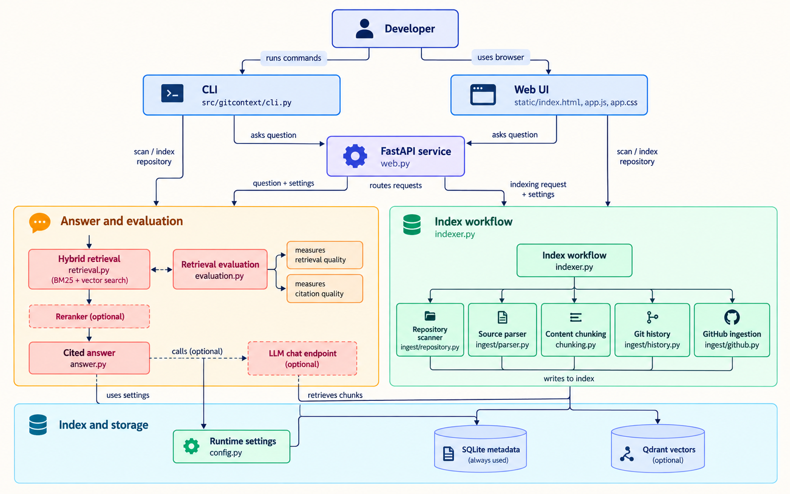

# GitContext

GitContext is a local-first RAG developer copilot for exploring unfamiliar
repositories. It indexes source code, project documentation, Git commit history,
and (for GitHub remotes) pull request discussions and labeled incident reports.
Questions return cited repository evidence, with optional LLM synthesis.

## Architecture



## Install

Python 3.12 or 3.13 is required.

```bash
python -m venv .venv
source .venv/bin/activate        # Windows: .venv\Scripts\activate
python -m pip install -e '.[dev,semantic]'
```

Sentence Transformers is in the optional `semantic` extra because it downloads a
local model and its runtime. Without it, GitContext still works with BM25
retrieval. Qdrant stores dense vectors locally under the repository's
`.gitcontext/` directory when semantic embeddings are enabled. SQLite stores
source text, provenance, file hashes, and settings.

## Use

```bash
gitcontext --help
gitcontext scan /path/to/repository
gitcontext index /path/to/repository
gitcontext ask "Where is authentication handled?" --path /path/to/repository
gitcontext web
```

GitHub repositories can be entered directly; you do not need to clone them
yourself. GitContext fetches the default-branch snapshot into its managed cache
and keeps the searchable index on this machine. Local folders and clones remain
supported too.

```bash
gitcontext scan https://github.com/owner/repository
gitcontext index https://github.com/owner/repository
gitcontext ask "Where is authentication handled?" \
  --path https://github.com/owner/repository
```

The web UI accepts the same GitHub URL. Private repositories require a
`GITHUB_TOKEN` with repository read access. The `GITCONTEXT_REMOTE_CACHE`
environment variable can change where fetched repository snapshots are cached.

`gitcontext web` starts the FastAPI service and opens the browser UI at
`http://127.0.0.1:8765`. API documentation is available at `/docs`. Paste a
repository path in the UI, scan it, build the index, then ask questions. The
server binds to localhost by default. Use `--host` and `--port` to choose another
address; only bind beyond localhost on a network you trust.

The scanner supports Python, JavaScript, JSX, TypeScript, TSX, Java, Markdown,
MDX, reStructuredText, text, YAML, TOML, JSON, HTML, XML, SQL, and shell files.
Python declarations are parsed with Python's AST. JavaScript, TypeScript, and
Java declarations use Tree-sitter. Documentation is chunked by Markdown
headings or overlapping line windows. Oversized declarations are split with
overlap.

## Semantic retrieval and reranking

Set a local embedding model before indexing. The model is downloaded on first
use; reranking is an optional second pass using a cross-encoder model.

```bash
export GITCONTEXT_EMBEDDING_MODEL=sentence-transformers/all-MiniLM-L6-v2
export GITCONTEXT_RERANKER_MODEL=cross-encoder/ms-marco-MiniLM-L-6-v2
gitcontext index /path/to/repository
gitcontext ask "How does authentication work?" --path /path/to/repository
```

Hybrid search combines BM25 for names and exact text with Qdrant dense-vector
search when embeddings exist. The cross-encoder reranks the leading candidates.
If no model is configured, retrieval stays offline and lexical.

## Answer synthesis

To synthesize answers from retrieved evidence, configure an OpenAI-compatible
chat endpoint. The default endpoint is OpenAI; set `OPENAI_BASE_URL` and
`GITCONTEXT_LLM_MODEL` for a compatible provider.

```bash
export OPENAI_API_KEY=...
export GITCONTEXT_LLM_MODEL=gpt-4o-mini
gitcontext ask "How does the CLI register commands?" --path /path/to/repository
```

The prompt instructs the model to cite exact source paths and line ranges and to
say when the retrieved context does not answer the question.

## Git history and GitHub context

Indexing a local clone includes recent Git commits, file-level last-change
commit, author, and timestamp. For direct GitHub URLs, GitContext indexes recent
commit messages plus pull requests, conversation comments, review comments,
and issues labeled `incident`, `postmortem`, `outage`, or `incident-report`.
Public repositories can be read without authentication; set `GITHUB_TOKEN` for
private repositories and higher API limits. Set `GITCONTEXT_INGEST_GITHUB=false`
to skip GitHub history and discussions, and `GITCONTEXT_HISTORY_LIMIT=0` to skip
commit history.

The GitHub sync is bounded to recent commits, pull requests, and incidents to
limit API traffic. Direct GitHub indexes check the latest default-branch commit
before answering and refresh the managed snapshot when it changes. Rate-limit or
access failures appear as warnings and do not prevent source indexing. Run
`gitcontext index <github-url>` to refresh the repository and discussions.

## Freshness and metadata

The index stores file hashes and automatically skips unchanged files on a new
index run. Changed files are reparsed and re-embedded; removed files are dropped.
`ask` checks the current files and Git HEAD and refreshes stale local code and
history before retrieval. File records include path, source type, last commit,
author, and modified date. PR and incident records include author, update date,
PR/issue number, and GitHub URL.

The default index is `<repository>/.gitcontext/index.sqlite`; set
`GITCONTEXT_DATABASE` to store it elsewhere. Do not commit secrets. `.gitcontext/`
is ignored by Git.

## Evaluation

Create a JSON fixture containing questions, relevant file paths, and optional
reference answers, then run:

```bash
gitcontext evaluate eval/example.json --path /path/to/repository --k 5
```

The report includes Recall@K, Precision@K, mean reciprocal rank, retrieval
latency, citation relevance, and (when reference answers are supplied) answer
token F1. `eval/example.json` is a starter fixture; use repository-specific
questions and reviewed relevance labels before reporting resume metrics.
When `OPENAI_API_KEY` is set, evaluation sends each question through the
configured answer endpoint; without it, evaluation scores the local evidence
answer and makes no model requests.

## Development

```bash
pytest
ruff check src tests
```
