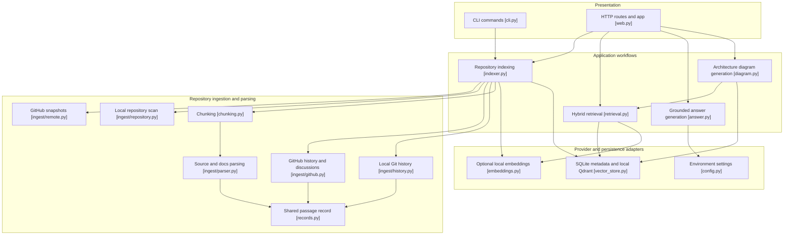
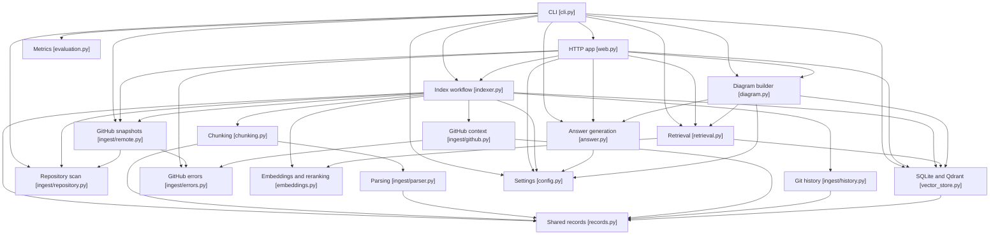

# GitContext backend architecture

## Audit summary

The repository is a Python modular monolith in `src/gitcontext/`. It does not
contain the illustrative `backend/application/infrastructure` directory tree.
The FastAPI app and Typer CLI are entry points over shared indexing, retrieval,
and storage modules. The package has no separate domain, repository-interface,
or application-service directories.

An AST scan of internal Python imports found no strongly connected components.
Runtime calls are separate from imports: for example, `web.py` calls the
indexing workflow, but that call is not evidence of a circular import. The
indexing path is coordinated by `indexer.py`; API handlers remain in
`web.py`. A dependency-neutral `records.py` now owns `ParsedBlock`, so parser,
indexing, GitHub/history ingestion, and vector storage share the record without
storage importing the parser implementation. `ingest.parser.ParsedBlock`
remains available as a compatibility import.

Supported-file read and UTF-8 decode errors now fail indexing with the relative
path in the error. Previously an unreadable file was counted as skipped, which
could leave old chunks in place while returning a successful summary. Changes
still persist one file at a time; a later storage or embedding failure can leave
earlier file updates committed. Full indexing transactions across SQLite and
Qdrant remain technical debt.

GitHub transport failures now use a distinct `GitHubAPIError`. The web API maps
invalid repository input to 400, GitHub upstream failures to 502, and local
index/storage failures to 500. Upstream response bodies are not returned to API
clients.

## Diagram 1: Package responsibilities

Arrows in this diagram show runtime flow. The nodes name actual modules or
module groups in the repository.

## Diagram 2: Actual import dependencies

Arrows mean Python imports, including the CLI's lazy import of `web.py` inside
the `web` command. They do not represent runtime data flow. No cycles were found
in the checked internal import graph.

## Diagram 3: Runtime workflows

This diagram reflects the current implementation. GitHub discussion ingestion is
optional and can produce warnings while code indexing succeeds. Semantic search
and reranking are optional. There is no graph lookup stage or citation-validation
stage in question answering.

```mermaid
flowchart TB
  subgraph indexing["Repository indexing"]
    input["Repository URL or local path"] --> entry["CLI or POST /api/index"]
    entry --> validate["Validate input and resolve repository"]
    validate --> fetch["Fetch GitHub metadata and source snapshot"]
    validate --> scan["Scan supported local files"]
    fetch --> scan
    scan --> parse["Parse and chunk source and documentation"]
    parse --> enrich["Read local Git history or remote GitHub commits, PRs and incidents"]
    parse --> embed["Generate vectors when an embedding model is configured"]
    enrich --> persist["Store passages and metadata in SQLite"]
    embed --> persist
    persist --> sync["Sync dense vectors to local Qdrant when present"]
    sync --> complete["Return indexing summary and warnings"]
  end

  subgraph answering["Question answering"]
    question["Question and repository"] --> qentry["CLI ask or POST /api/ask"]
    qentry --> freshness["Check local hashes or fetch GitHub head status"]
    freshness -->|"stale remote index"| reindex["Refresh remote snapshot and index"]
    freshness --> retrieve["Retrieve indexed passages"]
    reindex --> retrieve
    retrieve --> bm25["BM25 lexical ranking"]
    retrieve --> vector["Optional Qdrant vector search"]
    bm25 --> rank["Combine candidates"]
    vector --> rank
    rank --> rerank["Optional cross-encoder reranking"]
    rerank --> llm["Use configured LLM when a key and evidence exist"]
    rerank --> fallback["Return cited evidence excerpt otherwise"]
    llm --> response["Answer plus source metadata"]
    fallback --> response
  end
```

## Verified behavior and remaining risks

- The API currently accepts public GitHub URLs. The CLI also accepts local
  folders. `/api/ask` checks GitHub freshness and can download and re-index a
  changed repository before answering; repeated requests therefore make GitHub
  API calls and can trigger costly indexing. Rate limiting and per-repository
  refresh coordination are not implemented here.
- Retrieval always uses BM25. Qdrant vector search requires an embedding model
  and stored vectors. A cross-encoder reranker is used only when configured.
- The answer prompt asks the model to cite retrieved paths and line ranges, but
  generated claims are not validated against the source list. The API's
  separate `sources` field is populated from retrieval results.
- SQLite metadata and file hashes are the durable index records. Qdrant is a
  local dense-vector collection rebuilt by `sync_qdrant`; it is not a separate
  graph database. There is no persisted code graph or graph-based retrieval.
- Settings are loaded from environment variables when requested. Model loading
  is lazy and cached; importing the API module creates the FastAPI app but does
  not fetch repositories or load embedding models.
