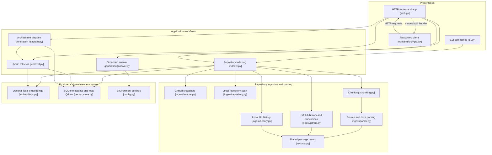
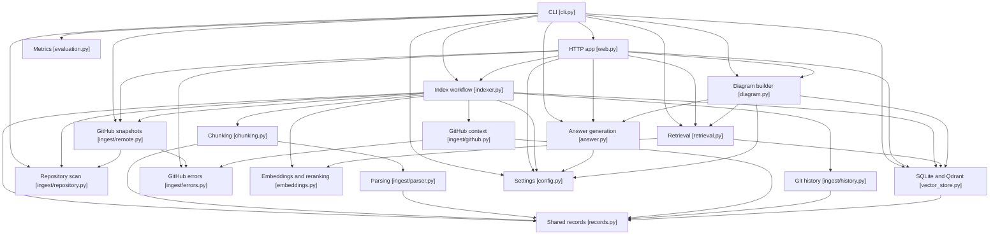

# GitContext backend architecture

## Audit summary

The repository is a Python modular monolith in `src/gitcontext/`. It does not
contain the illustrative `backend/application/infrastructure` directory tree.
The FastAPI app and Typer CLI are entry points over shared indexing, retrieval,
and storage modules. The web app serves a React client built with Vite; the
client calls the existing FastAPI endpoints. The package has no separate
domain, repository-interface, or application-service directories.

An AST scan of internal Python imports found no strongly connected components.
Runtime calls are separate from imports: for example, `web.py` calls the
indexing workflow, but that call is not evidence of a circular import. The
indexing path is coordinated by `indexer.py`; API handlers remain in
`web.py`. A dependency-neutral `records.py` now owns `ParsedBlock`, so parser,
indexing, GitHub/history ingestion, and vector storage share the record without
storage importing the parser implementation. `ingest.parser.ParsedBlock`
remains available as a compatibility import.

This remains a modular monolith rather than a full Clean Architecture split.
`indexer.py` and `retrieval.py` import concrete embedding and `VectorStore`
implementations. There are no replaceable persistence or model ports. The
current code has one local SQLite/Qdrant store and one embedding implementation,
so adding protocols around every function would add indirection without a
second adapter. `web.py` owns HTTP concerns and calls the shared indexing and
retrieval functions; indexing orchestration remains in `indexer.py`.

Supported-file read and UTF-8 decode errors now fail indexing with the relative
path in the error. Previously an unreadable file was counted as skipped, which
could leave old chunks in place while returning a successful summary. Changes
still persist one file at a time; a later storage or embedding failure can leave
earlier file updates committed. Full indexing transactions across SQLite and
Qdrant remain technical debt.

GitHub transport failures now use a distinct `GitHubAPIError`. The web API maps
invalid repository input to 400, GitHub upstream failures to 502, and local
index/storage failures to a generic 500 response. Upstream response bodies and
internal exception text are not returned to API clients. Generated answer
citation ranges are checked against retrieved passages; if no citation is
present or a citation is unsupported, the response falls back to cited source
excerpts. The check validates citation paths and ranges, not whether every
natural-language claim is true.

## Diagram 1: Package responsibilities

Arrows in this diagram show runtime flow. The nodes name actual modules or
module groups in the repository.

## Diagram 2: Actual import dependencies

Arrows mean Python imports, including the CLI's lazy import of `web.py` inside
the `web` command. They do not represent runtime data flow. This diagram does
not include the separate JavaScript module graph bundled by Vite. No cycles were
found in the checked internal Python import graph.

## Diagram 3: Runtime workflows

This diagram reflects the current implementation. GitHub discussion ingestion is
optional and can produce warnings while code indexing succeeds. Semantic search
and reranking are optional. There is no code-graph lookup stage in indexing or
question answering; the architecture diagram is generated separately from source
imports and detected HTTP calls.

## Verified behavior and remaining risks

- The API currently accepts public GitHub URLs. The CLI also accepts local
  folders. `/api/ask` checks GitHub freshness and can download and re-index a
  changed repository before answering; repeated requests therefore make GitHub
  API calls and can trigger indexing. Per-repository locks return `409` for a
  concurrent scan, index, or ask/refresh on the same normalized repository.
  In-memory sliding-window limits apply 5 index requests per 5 minutes and 15
  scan, ask, or diagram requests per minute per client IP. Both controls are per
  process and do not coordinate separate workers or replicas.
- Direct GitHub ingestion checks repository size and recursive Git tree blob
  count before downloading the snapshot archive. Defaults are 100 MB and 1,500
  blobs, configurable through `GITCONTEXT_MAX_REPO_MB` and
  `GITCONTEXT_MAX_FILES`.
- Blocking remote indexing, freshness checks, repository scans, retrieval, and
  answer synthesis run in worker threads so they do not block the ASGI event
  loop.
- Retrieval always uses BM25. Qdrant vector search requires an embedding model
  and stored vectors. A cross-encoder reranker is used only when configured.
- The citation guard checks that generated `path:start-end` citations fall
  inside retrieved chunks. It does not verify factual claims. The API's separate
  `sources` field is populated from retrieval results.
- SQLite metadata and file hashes are the durable index records. Qdrant is a
  local dense-vector collection rebuilt by `sync_qdrant`; it is not a separate
  graph database. There is no persisted code graph or graph-based retrieval.
- Each changed file and its chunks are replaced in one SQLite transaction.
  A later read, embedding, GitHub, or Qdrant failure can leave earlier file or
  source-type updates committed. There is no repository-wide transaction across
  SQLite and Qdrant. The stored head is written after vector synchronization so
  a failed run is not marked complete, but partial records can still exist.
- Remote indexing now defers Qdrant synchronization until GitHub commit, PR, and
  incident records have been written. This avoids rebuilding the same local
  collection twice for each remote index run.
- Settings are loaded from environment variables when requested. Model loading
  is lazy and cached; importing the API module creates the FastAPI app but does
  not fetch repositories or load embedding models.
